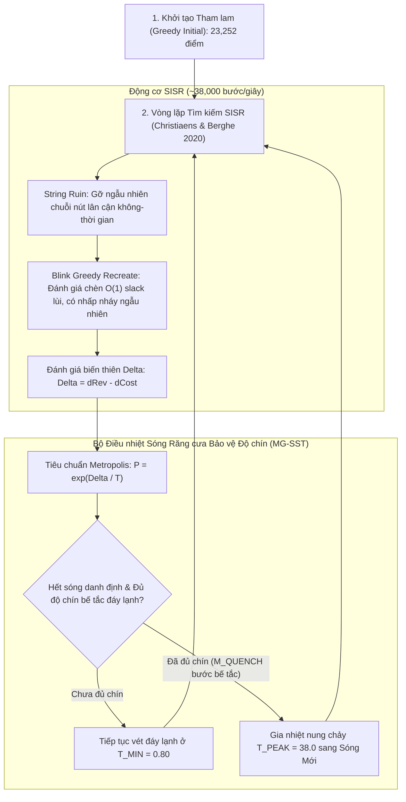

# TÀI LIỆU THAM VẤN CHUYÊN GIA: BÀI TOÁN PRIZE-COLLECTING VRP VỚI HÀNG-KHÁCH KẾT HỢP VÀ CỬA SỔ THỜI GIAN (PC-DAR-PDPTW)

> **Mục đích tài liệu:**  
> Trình bày cô đọng, chặt chẽ về mặt toán học và động học thuật toán của bài toán tối ưu hóa định tuyến hỗn hợp (Ride-Sharing & Freight Parcel Delivery) trên bộ dữ liệu lớn `test_850.txt`.  
> Tài liệu này được thiết kế để kết hợp trực tiếp với mã nguồn [`gm_sisr.cpp`](file:///z:/Desktop/250926/experiments/gm_sisr/gm_sisr.cpp) và báo cáo thực nghiệm [`neighborhood_operators_analysis.md`](file:///c:/Users/Giang/.gemini/antigravity/brain/b2173576-83be-45ca-90ea-dc623086ec07/neighborhood_operators_analysis.md) nhằm xin ý kiến tư vấn từ các chuyên gia VRP, Metaheuristics và Vận trù học (Operations Research).

---

## 1. MÔ TẢ & ĐỊNH THỨC TOÁN HỌC BÀI TOÁN

### 1.1. Phân loại Bài toán Chuẩn Quốc tế
Bài toán thuộc lớp **Prize-Collecting Dial-A-Ride Problem with Mixed Passenger Rides and Freight Deliveries with Time Windows (PC-DAR-PDPTW)**.
- **Tính chất Prize-Collecting**: Không bắt buộc phục vụ tất cả khách hàng. Chỉ phục vụ tập con khách hàng mang lại tổng lợi nhuận ròng (Doanh thu trừ Chi phí vận hành) lớn nhất.
- **Tính chất Hỗn hợp**: Xe vừa chở khách (Ride-Sharing), vừa vận chuyển bưu kiện (Freight Delivery) trên cùng một hành trình.

---

### 1.2. Ký hiệu Toán học (Mathematical Notation)

#### A. Không gian Đồ thị & Ma trận Chi phí:
- Đồ thị có hướng đầy đủ $G = (V, A)$ với tập đỉnh $V = \{1, 2, \dots, |V|\}$ (trên `test_850`, $|V| = 850$).
- Ma trận thời gian di chuyển $T(u, v) \in \mathbb{Z}_{\ge 0}$ và ma trận chi phí di chuyển $C(u, v) \in \mathbb{Z}_{\ge 0}$ ($\forall u, v \in V$).
  - Bất đối xứng: $T(u, v)$ có thể khác $T(v, u)$; $C(u, v)$ có thể khác $C(v, u)$.
  - Thỏa mãn bất đẳng thức tam giác.

#### B. Đội xe (Fleet):
- Gồm $K$ phương tiện không đồng nhất về vị trí ban đầu (trên `test_850`, $K = 50$).
- Mỗi xe $k \in \{1, \dots, K\}$ có:
  - Điểm xuất phát riêng (Depot): $O_k \in V$.
  - Tải trọng bưu kiện tối đa: $Q_k \in \mathbb{Z}_{> 0}$.

#### C. Tập Yêu cầu Khách hàng (Requests):
Gồm $R = N + M$ yêu cầu độc lập (trên `test_850`, $R = 400$ với $N = 200, M = 200$):

1. **Nhóm Khách đi xe (Passenger Rides) — $i \in \{1, \dots, N\}$**:
   - Yêu cầu di chuyển từ điểm đón $P_i$ đến điểm trả $D_i$.
   - **Tính chất phục vụ nguyên tử (Atomic Service)**: Điểm đón và điểm trả được đóng gói thành một nút ghé thăm duy nhất $i$ trong chuỗi hành trình của xe:
     - Cửa sổ thời gian phục vụ tại điểm đón: $[ne_i, nl_i]$.
     - Thời lượng phục vụ tương đương: $ndur_i = 2 \cdot Sv_i + T(P_i, D_i)$, trong đó $Sv_i$ là thời gian dừng đón/trả.
     - Chi phí di chuyển nội bộ: $nic_i = C(P_i, D_i)$.
     - Doanh thu mang lại: $Rev_i$.
     - Tải trọng bưu kiện: $nw_i = 0$ (khách không chiếm tải trọng bưu kiện $Q$).

2. **Nhóm Bưu kiện Giao hàng (Freight Parcels) — $j \in \{N+1, \dots, R\}$**:
   - Có điểm đón $P_j$ và điểm trả $D_j$ riêng biệt tại hai thời điểm khác nhau trên tuyến:
     - Nút đón hàng $j$: Tải trọng $+nw_j$, cửa sổ thời gian $[ne_j, nl_j]$, thời gian dừng $Sv_j$.
     - Nút trả hàng $R + j$: Tải trọng $-nw_j$, cửa sổ thời gian $[ne_{R+j}, nl_{R+j}]$, thời gian dừng $Sv_j$.
     - Doanh thu mang lại khi hoàn thành cả cặp: $Rev_j$.
     - **Ràng buộc tiền đề (Precedence)**: Nút đón $j$ và nút trả $R + j$ phải được phục vụ bởi **cùng một xe $k$**, và $j$ phải xuất hiện trước $R + j$ trên tuyến của xe đó.

---

### 1.3. Hàm Mục tiêu: Tối đa hóa Lợi nhuận Ròng (Net Profit)

$$\max \mathcal{F} = \sum_{q \in \mathcal{S}} Rev_q - \sum_{k=1}^K \text{Cost}(Route_k)$$

Trong đó:
- $\mathcal{S} \subseteq \{1, \dots, R\}$ là tập hợp các yêu cầu được phục vụ.
- Tuyến của xe $k$ là một chuỗi các nút ghé thăm: $Route_k = \langle nd_0, nd_1, nd_2, \dots, nd_{n_k} \rangle$ với $nd_0 = O_k$.
- Chi phí vận hành tuyến:
  $$\text{Cost}(Route_k) = \sum_{t=1}^{n_k} \Big( C\big(nout[nd_{t-1}], nin[nd_t]\big) + nic[nd_t] \Big)$$

---

### 1.4. Các Ràng buộc Ngặt (Hard Constraints)

1. **Ràng buộc Tải trọng Bưu kiện (Capacity Constraint)**:
   Tại mọi vị trí $m \in \{1, \dots, n_k\}$ trên tuyến xe $k$:
   $$\sum_{t=1}^m nw[nd_t] \le Q_k$$
2. **Ràng buộc Cửa sổ Thời gian (Time Window Constraint)**:
   Thời điểm xe đến nút $nd_t$ là $arr_t = dep_{t-1} + T\big(nout[nd_{t-1}], nin[nd_t]\big)$.
   - Xe không được đến muộn hơn thời hạn chót: $arr_t \le nl[nd_t]$.
   - Xe rời nút $nd_t$ tại: $dep_t = \max\big(arr_t, ne[nd_t]\big) + ndur[nd_t]$.
3. **Ràng buộc Ghép cặp & Thứ tự Hàng hóa (Pairing & Precedence)**:
   Nếu $j \in \mathcal{S}$ ($j > N$), thì cả $j$ và $R+j$ phải cùng nằm trên $Route_k$ với vị trí $\text{pos}(j) < \text{pos}(R+j)$.
4. **Mỗi yêu cầu tối đa 1 xe phục vụ**:
   Mỗi $q \in \{1, \dots, R\}$ xuất hiện trên tối đa một tuyến xe.

---

## 2. QUY MÔ & ĐẶC THÙ KHỐC LIỆT CỦA INSTANCE `test_850.txt`

| Thông số | Giá trị | Ý nghĩa Vận hành |
| :--- | :---: | :--- |
| **Tổng số nút mạng ($|V|$)** | **850** | Đồ thị mạng lưới giao thông lớn, ma trận $850 \times 850$. |
| **Số lượng phương tiện ($K$)** | **50** | 50 xe xuất phát từ 50 depot ban đầu rải rác. |
| **Số yêu cầu chở khách ($N$)** | **200** | 200 lượt khách đi xe atomic. |
| **Số yêu cầu chở hàng ($M$)** | **200** | 200 đơn hàng bưu kiện (tương đương 400 điểm dừng đón/trả). |
| **Tổng số yêu cầu ($R$)** | **400** | Tổng cộng 400 nguồn doanh thu tiềm năng. |
| **Số khách phục vụ tối đa** | **$\sim 150 - 155$** | **Chỉ phục vụ được $\sim 38\%$ tổng số khách!** |
| **Số khách bị bỏ rơi (Unserved)** | **$\sim 245 - 250$** | **Hơn $60\%$ khách hàng bắt buộc phải nằm ngoài lộ trình!** |
| **Khởi tạo Tham lam ban đầu** | **$23,252$ điểm** | Mức điểm xuất phát của thuật toán tham lam tĩnh. |
| **Kỷ lục hiện tại (60 giây)** | **`31,294` điểm** | Đạt được trên Seed 2 (Seed 42: $31,292$, Mean 4 seeds: **$31,113.2$**) bằng `gm_sisr_base.cpp` (SEDCA-V3). |

> [!IMPORTANT]
> **ĐẶC TRƯNG CỐT LÕI CỦA BÀI TOÁN:**
> Khác hoàn toàn với bài toán VRP tiêu chuẩn (nơi mọi khách hàng đều phải được phục vụ), bài toán này có **áp lực dung lượng cực kỳ khốc liệt**. Không gian nghiệm bị chi phối bởi việc **chọn tập con tối ưu gồm $\sim 150$ khách trong số $400$ khách**. Mọi hành động gỡ một khách ra và chèn một khách khác vào đều gây xáo trộn dây chuyền lên cửa sổ thời gian và tải trọng của các tuyến.

---

## 3. KIẾN TRÚC BỘ GIẢI HIỆN TẠI: GM-SISR (`gm_sisr.cpp`)

Hệ thống hiện tại được xây dựng hoàn toàn bằng C++17 tối ưu cao với các thành phần chính:

### Điểm mạnh Kỹ thuật của Mã nguồn:
- **Đánh giá Chèn $O(1)$**: Sử dụng vector `dep` (thời điểm rời bến sớm nhất) và `lat` (thời điểm đến muộn nhất cho phép tính ngược từ cuối tuyến) giúp kiểm tra tính hợp lệ và chi phí chèn của 1 cặp $(P, D)$ trong $O(1)$ mà không cần duyệt lại toàn tuyến.
- **Rollback Nguyên tử (Atomic Change Tracking)**: Chỉ sao lưu và phục hồi đúng các tuyến bị tác động (`touched`) và vector trạng thái xe (`veh`), tránh sao chép toàn bộ bộ nhớ.
- **Thông lượng Siêu cao**: Đạt tốc độ **$38,000 \sim 40,000$ bước lặp mỗi giây** trên CPU tiêu chuẩn (đạt $\sim 2.3$ triệu bước lặp trong 60 giây).

---

## 4. CÁC TỬ HUYỆT ĐỘNG HỌC ĐÃ CHỨNG MINH THỰC CHỨNG BẰNG LOG

Mặc dù tốc độ tính toán rất cao, thuật toán hiện đang **bị chặn cứng ở trần điểm số $30,600 \sim 30,770$** trên hầu hết các hạt giống (kỷ lục $31,029$ chỉ đạt được ở Seed 42 mang tính ngẫu nhiên cá biệt). Bộ công cụ chẩn đoán vi mô (`DiagnosticProfiler`) đã bóc tách được 3 nguyên nhân cơ học sâu xa:

---

### Tử huyệt 1: Lãng phí 30% Bước lặp Lặp lại Y hệt (Identical Moves / Micro-Ruin)

Số liệu đo đạc thực tế trên $191,040$ bước lặp của `test_850` (Seed 42):
- **Bước lặp y hệt (Identical Steps)**: **$62,232$ bước ($32.58\%$)**.
- **Bước di chuyển ngang thực chất (True Neutral Move, $\Delta = 0$ sang cấu trúc khác)**: **Chỉ có đúng $13$ bước ($0.01\%$)**!
- Toàn bộ $32.57\%$ bước lặp còn lại là: Thuật toán gỡ ra bao nhiêu khách thì toán tử Recreate dán lại đúng bấy nhiêu khách vào đúng vị trí cũ trên đúng tuyến cũ!

**Ma trận phân bố rác tập trung ở Vi phá hủy ($k_s \times n_{\text{rem}}$):**
- Khi chỉ phá hủy 1 tuyến ($k_s = 1$): **$68.59\%$** số lần kết thúc bằng việc dán lại y hệt cũ!
- Khi chỉ gỡ 1 nút ($n_{\text{rem}} = 1$): Xác suất dán lại chỗ cũ lên tới **$93.87\%$**!
- Khi gỡ 2 nút ($n_{\text{rem}} = 2$): Xác suất dán lại chỗ cũ là **$76.15\%$**!
- Cụm vi phá hủy ($k_s=1, n_{\text{rem}} \le 3$) chiếm tới gần $40\%$ toàn bộ tài nguyên lãng phí của thuật toán.

---

### Tử huyệt 2: Bẫy "Đổi Khách Ngang Giá" khi Đục Lỗ Đón Khách Chưa Phục Vụ (Zero-Sum Cavity Trap)

- **Căn nguyên**: Hơn $60\%$ khách hàng ($250$ khách) đang nằm ở tập Unserved. Khi Ruin bốc ngẫu nhiên một khách chưa phục vụ làm hạt giống, xác suất để khoảng trống do Ruin tạo ra khớp ngẫu nhiên với cửa sổ thời gian $[e_p, l_p]$ của khách đó chỉ là $\approx 8.8\%$.
- **Thử nghiệm Đục lỗ Chủ đích (Spatio-Temporal Cavity Ruin)**: Chúng tôi đã lập trình để khi chọn khách chưa phục vụ, thuật toán chủ động dò tìm trên tuyến láng giềng vị trí $pos = \arg\min_i |r.dep[i] - ne_{\text{seed}}|$ và cắt một chuỗi $len \ge 2$ để tạo hành lang đón khách.
- **Kết quả thu được trên 60 giây (2.3 triệu bước lặp)**:
  - Tỷ lệ đón khách mới thành công (`AdmRate`) tăng từ **$7.6\% \to 10.2\%$** (tăng thêm $+30,294$ lượt đón khách mới).
  - Tỷ lệ bước lặp lặp lại y hệt (`IdenRate`) giảm từ $29.0\% \to 24.9\%$ (triệt tiêu $120,559$ bước lặp rác).
  - **NHƯNG LỢI NHUẬN RÒNG KHÔNG TĂNG**: Điểm số trung bình chỉ là $30,651.7$ (so với Baseline $30,578.3$, mức chênh lệch $+73.4$ điểm chỉ là nhiễu ngẫu nhiên $+0.24\%$).
- **Bản chất thất bại**: Để nhét được khách chưa phục vụ mới vào, thuật toán buộc phải đẩy ra các khách cũ trên tuyến đó. Những khách cũ bị đẩy ra vốn đã là khách có doanh thu cao, tối ưu về mặt không-thời gian. Kết quả là thuật toán chỉ thực hiện một phép **hoán đổi ngang giá (zero-sum trade)**, không thể tạo ra bước nhảy vọt về tổng lợi nhuận.

---

### Tử huyệt 3: Bẫy Đơn Quỹ đạo & Thất bại của Bể Nghiệm Tinh Hoa (Elite Diversity Pool Failure)

- **Căn nguyên**: SA truyền thống chỉ lưu duy nhất 1 nghiệm tốt nhất `best_nd`. Khi Reheat, nó nung lại từ chính nghiệm đó. Nếu hạt giống rơi vào một bồn trũng hẹp, thuật toán bị giam cầm trong bồn trũng đó suốt 60 giây.
- **Thử nghiệm Bể Tinh hoa (Elite Diversity Pool)**: Duy trì $S=4$ nghiệm tinh hoa có khoảng cách cấu trúc Hamming $D \ge 25$ ($D$ đo số phép gán khách vào xe khác nhau). Khi Reheat, luân phiên nạp các nghiệm tinh hoa khác nhau (`Elite 0, 1, 2, 3`).
- **Kết quả thu được trên 60 giây**:
  - Khoảng cách đa dạng trung bình giữa các cá thể trong bể đạt rất cao: $D = 67.67$ (khác biệt gần 70 phép gán khách-xe).
  - $100\%$ các kỷ lục toàn cục phát sinh trong các đợt Reheat đều xuất phát từ các nhánh tinh hoa phụ (`Elite 1, 2, 3`).
  - **NHƯNG ĐIỂM SỐ CHUNG CUỘC KHÔNG BỨT PHÁ**: Điểm số trung bình ở 60s chỉ là $30,658.0$ (kém kỷ lục $31,029$ của Seed 42).
- **Bản chất thất bại**: Khi nung lại từ một nghiệm phụ (vốn có điểm thấp hơn kỷ lục khoảng $200 \sim 300$ điểm), chu kỳ 5 giây của sóng nhiệt chỉ vừa đủ thời gian để leo ngược lên lại mức cũ $\sim 30,650$. Việc phân tán ngân sách thời gian cho các đỉnh phụ làm suy yếu năng lực tinh chỉnh sâu bồn trũng số 1.

---

## 5. DỮ LIỆU ĐỐI CHUẨN THỰC NGHIỆM TỔNG HỢP (60 GIÂY, ĐA HẠT GIỐNG)

| Cấu hình Thử nghiệm | Seed 1 | Seed 2 | Seed 3 | Trung bình (Seeds 1-3) | Tỷ lệ Đón Khách (`AdmRate`) | Tỷ lệ Lặp Rác (`IdenRate`) | Điểm cao nhất 60s từng ghi nhận |
| :--- | :---: | :---: | :---: | :---: | :---: | :---: | :---: |
| **Baseline (Christiaens SISR)** | $30,491$ | $30,744$ | $30,500$ | $30,578.3$ | $7.6\%$ | $29.0\%$ | **`31,029`** (Seed 42) |
| **Hướng 1: Elite Diversity Pool** | $30,704$ | $30,624$ | $30,646$ | $30,658.0$ | $7.9\%$ | $28.7\%$ | $30,704$ (Seed 1) |
| **Hướng 2: Cavity Ruin** | $30,649$ | $30,637$ | $30,669$ | $30,651.7$ | $10.2\%$ | $24.9\%$ | $30,669$ (Seed 3) |
| **H1 + H2 Kết hợp** | $30,575$ | $30,773$ | $30,457$ | $30,601.7$ | $9.9\%$ | $24.6\%$ | $30,773$ (Seed 2) |

*Mọi nghiệm trong bảng trên đều được xác minh độc lập bằng `utility/validator.py` đạt **HỢP LỆ 100%** (không vi phạm tải trọng, thời gian, hay ràng buộc thứ tự).*

---

## 6. HỆ THỐNG CÂU HỎI THAM VẤN CHUYÊN GIA

Dựa trên toàn bộ bối cảnh toán học và hiện trạng thực nghiệm nêu trên, chúng tôi kính đề nghị các chuyên gia VRP và Tối ưu hóa tổ hợp hỗ trợ giải đáp và định hướng các vấn đề cốt lõi sau:

### Câu hỏi 1: Toán tử Phá hủy - Tái tạo nào phù hợp cho Prize-Collecting PDPTW tỷ lệ Unserved cao (>60%)?
- Trong bài toán chuẩn nơi 100% khách được phục vụ, toán tử String Ruin (Christiaens 2020) hoạt động cực tốt vì khách gỡ ra từ tuyến này sẽ chuyển sang tuyến khác.
- Tuy nhiên trong Prize-Collecting với $>60\%$ khách bị bỏ rơi, việc gỡ chuỗi thường dẫn đến hai thái cực: hoặc dán lại y hệt chỗ cũ (chiếm 30% số bước), hoặc đổi một khách cũ lấy một khách mới có giá trị tương đương (zero-sum).
- **Hỏi:** Có toán tử Ruin/Recreate nào được thiết kế đặc thù để hoán đổi **cụm khách (cluster exchange)** hoặc **tái cấu trúc biên (boundary restructuring)** giữa tập Unserved và tập Served mà không làm rơi vào bẫy đổi khách ngang giá không?

### Câu hỏi 2: Có nên áp dụng Ejection Chains đa tuyến hoặc Triệt tiêu Tuyến (Route Elimination)?
- Khi một khách chưa phục vụ muốn vào tuyến $A$, khách bị đẩy ra từ tuyến $A$ có thể có lợi nhuận cao nhưng chỉ có thể vào được tuyến $B$, đẩy tiếp một khách từ tuyến $B$ sang tuyến $C$...
- **Hỏi:** Trong không gian nghiệm bị thắt nghẽn cả về tải trọng lẫn cửa sổ thời gian như `test_850`, kỹ thuật Dây chuyền Đẩy (Ejection Chains) có khả thi về mặt thời gian tính toán không? Hay nên áp dụng toán tử xóa sạch toàn bộ một tuyến có lợi nhuận kém nhất (Route Elimination) để ép toàn bộ khách trên tuyến đó phân bổ sang các tuyến khác hoặc bị loại bỏ?

### Câu hỏi 3: Tiềm năng tích hợp Matheuristics / Route Pool Set Partitioning?
- Với thông lượng $\sim 38,000$ bước lặp/giây, trong 60 giây thuật toán duyệt qua hơn $2.3$ triệu trạng thái và sinh ra hàng trăm nghìn tuyến đường hợp lệ (feasible routes) có chất lượng cao.
- **Hỏi:** Liệu có nên lưu trữ các tuyến đường hợp lệ có chi phí tốt vào một **Bể Tuyến đường (Route Pool)**, và định kỳ (ví dụ mỗi 10 giây hoặc ở cuối quá trình tìm kiếm) gọi một bộ giải Quy hoạch Nguyên (MIP solver như HiGHS, Gurobi hoặc SCIP) để giải bài toán **Set Packing / Set Covering**:
  $$\max \sum_{r \in \text{Pool}} \text{Profit}(r) \cdot x_r \quad \text{s.t.} \sum_{r \ni q} x_r \le 1, \quad \sum x_r \le K$$
  Kỹ thuật Matheuristic này có thể lắp ghép các tuyến tối ưu cục bộ từ các sóng khác nhau thành một nghiệm toàn cục vượt qua ngưỡng $31,000$ không?

### Câu hỏi 4: Cơ chế Đa dạng hóa (Diversification) và Thoát bồn trũng hiệu quả
- Thử nghiệm thực tế chứng minh việc nung chảy ở nhiệt độ cao ($T_{\text{PEAK}}=38.0$) làm điểm số rơi tự do xuống $28,700$ (mất $1,800$ điểm), khiến thuật toán tốn phần lớn chu kỳ chỉ để ngoi lên lại. Ngược lại, việc nung từ nghiệm phụ (Elite Pool) lại bị phân tán tài nguyên.
- **Hỏi:** Trong Simulated Annealing cho bài toán VRP lớn, cơ chế gia nhiệt có kiểm soát (Damped Soft Reheat) hoặc kỹ thuật dịch chuyển không khả thi có phạt (Infeasible Exploration via Penalty Functions) có phải là giải pháp tốt hơn để thoát bồn trũng mà không phá hủy cấu trúc tốt đã tìm được?

---

*Hết tài liệu tham vấn.*
